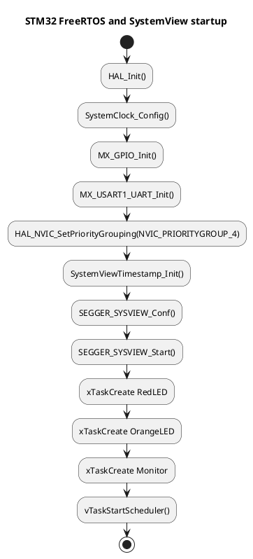
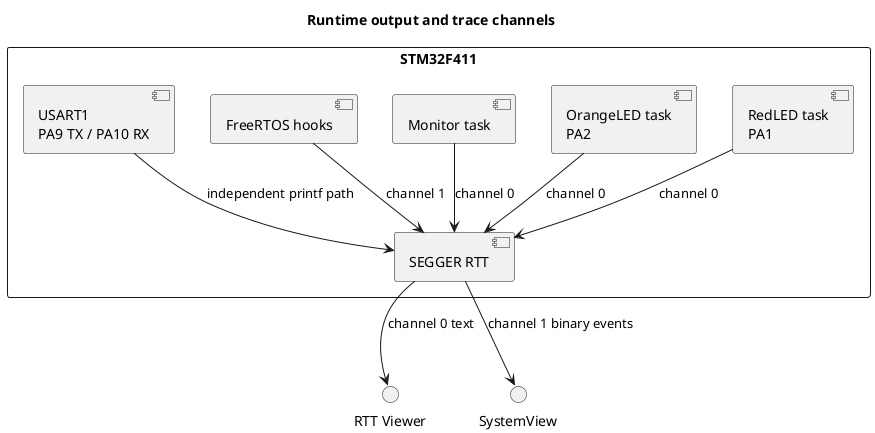

# FreeRTOS and SEGGER SystemView Setup

This document records the complete integration for the `001_Task` STM32CubeIDE project.

## Hardware

- MCU: STM32F411CEU6
- CPU clock: 16 MHz HSI
- Red LED: PA1, GPIO output
- Orange LED: PA2, GPIO output
- USART1 TX: PA9
- USART1 RX: PA10
- USART1 baud rate: 115200
- HAL time base: TIM10
- NVIC priority grouping: `NVIC_PRIORITYGROUP_4`

The GPIO and USART pin assignments are generated by `001_Task.ioc`. Keep those settings in CubeMX/CubeIDE and do not manually change generated initialization code unless necessary.

## Source locations

The application project is:

```text
/home/j-jayavardan/Projects/STM32/FreeRTOS/001_Task
```

FreeRTOS and SEGGER sources are shared from the sibling directory:

```text
/home/j-jayavardan/Projects/STM32/FreeRTOS/common/ThirdParty
```

SEGGER sources used by the project include:

- `SEGGER/SEGGER_RTT.c`
- `SEGGER/SEGGER_RTT_printf.c`
- `SEGGER/SEGGER_SYSVIEW.c`
- `SEGGER/OS/SEGGER_SYSVIEW_FreeRTOS.c`
- `SEGGER/Config/SEGGER_SYSVIEW_Config_FreeRTOS.c`
- `SEGGER/Syscalls/SEGGER_RTT_Syscalls_GCC.c`
- `SEGGER/Rec/segger_uart.c`
- `SEGGER_RTT_ASM_ARMv7M.S`

## Header integration

The original CubeIDE compile commands did not include every SEGGER header directory. Forwarding headers were added beside the SEGGER sources so the vendor source files can resolve their configuration without changing generated CubeIDE makefiles.

Forwarding headers are located in:

```text
common/ThirdParty/SEGGER/SEGGER/Global.h
common/ThirdParty/SEGGER/SEGGER/SEGGER_RTT_Conf.h
common/ThirdParty/SEGGER/SEGGER/SEGGER_SYSVIEW_Conf.h
common/ThirdParty/SEGGER/OS/SEGGER_SYSVIEW.h
common/ThirdParty/SEGGER/Config/SEGGER_SYSVIEW.h
common/ThirdParty/SEGGER/Rec/SEGGER_SYSVIEW.h
common/ThirdParty/SEGGER/Rec/SEGGER_RTT.h
common/ThirdParty/SEGGER/SEGGER/Syscalls/SEGGER_RTT.h
```

`FreeRTOSConfig.h` includes the SEGGER FreeRTOS adapter using a project-relative path:

```c
#include "../../../common/ThirdParty/SEGGER/OS/SEGGER_SYSVIEW_FreeRTOS.h"
```

`main.c` similarly includes the SEGGER core headers using project-relative paths.

## FreeRTOS configuration

The important settings in `Core/Inc/FreeRTOSConfig.h` are:

```c
#define configUSE_PREEMPTION                 1
#define configCPU_CLOCK_HZ                   ( SystemCoreClock )
#define configTICK_RATE_HZ                  ( ( TickType_t ) 1000 )
#define configMAX_PRIORITIES                 5
#define configTOTAL_HEAP_SIZE               ( ( size_t ) ( 75 * 1024 ) )
#define configUSE_TRACE_FACILITY             1
#define configLIBRARY_LOWEST_INTERRUPT_PRIORITY       0xf
#define configLIBRARY_MAX_SYSCALL_INTERRUPT_PRIORITY  5
```

The SEGGER adapter must have context checking enabled:

```c
#define SYSVIEW_PORT_PROVIDES_CONTEXT_CHECK 1
```

This is important. With context checking disabled, the adapter calls `xTaskGetTickCountFromISR()` even from normal task context, which triggers the FreeRTOS priority assertion.

## SystemView configuration

`SEGGER_SYSVIEW_Config_FreeRTOS.c` contains the application and target description:

```c
#define SYSVIEW_APP_NAME        "FreeRTOS Task_001 Application"
#define SYSVIEW_DEVICE_NAME     "STM32F411CEU6"
#define SYSVIEW_TIMESTAMP_FREQ  ( configCPU_CLOCK_HZ )
#define SYSVIEW_CPU_FREQ       configCPU_CLOCK_HZ
#define SYSVIEW_RAM_BASE       ( 0x20000000 )
```

`0x20000000` is the SRAM base for the STM32F411. The original `0x10000000` value was not suitable for this target.

The project uses J-Link RTT for SystemView transport:

```c
#define SEGGER_UART_REC 0
```

The optional supplied UART recorder is disabled because that source is configured for USART2/PA2-PA3, while this project uses USART1/PA9-PA10.

## DWT timestamp setup

SystemView uses the Cortex-M4 DWT cycle counter for timestamps. The counter must be enabled before SystemView initialization. `main.c` calls this function after HAL and peripheral initialization:

```c
static void SystemViewTimestamp_Init(void)
{
  CoreDebug->DEMCR |= CoreDebug_DEMCR_TRCENA_Msk;
  DWT->CYCCNT = 0U;
  DWT->CTRL |= DWT_CTRL_CYCCNTENA_Msk;
}
```

Without this setup, SystemView receives events but all timestamps remain zero. The result is an empty timeline, zero event durations, and unavailable CPU-load graphs.

## Application startup order

The startup order in `main.c` is intentional:

```c
HAL_Init();
SystemClock_Config();
MX_GPIO_Init();
MX_USART1_UART_Init();
HAL_NVIC_SetPriorityGrouping(NVIC_PRIORITYGROUP_4);
SystemViewTimestamp_Init();
SEGGER_SYSVIEW_Conf();
SEGGER_SYSVIEW_Start();
```

The two tasks are then created and the scheduler is started:

```c
xTaskCreate(RedLedTask, "RedLED", 200U, NULL, 1, NULL);
xTaskCreate(OrangeLedTask, "OrangeLED", 200U, NULL, 1, NULL);
vTaskStartScheduler();
```

Task behavior:

- `RedLedTask`: toggles PA1 every 500 ms
- `OrangeLedTask`: toggles PA2 every 1000 ms
- Both tasks write messages using `SEGGER_RTT_printf()`

The scheduler must be started after the SystemView configuration and task creation. Do not call `SEGGER_SYSVIEW_Start()` from an ISR.

## PlantUML diagrams

### Startup sequence

Save this block as `systemview-startup.puml` or paste it into a PlantUML viewer:



### Runtime data flow



## printf output

Normal C library `printf()` output is routed to USART1 by `_write()` in `Core/Src/syscalls.c`:

```c
int _write(int file, char *ptr, int len)
{
  (void)file;
  if (HAL_UART_Transmit(&huart1, (uint8_t *)ptr, (uint16_t)len,
                        HAL_MAX_DELAY) != HAL_OK)
  {
    return -1;
  }
  return len;
}
```

Connect a USB-UART adapter as follows:

| STM32 | USB-UART |
|---|---|
| PA9 / USART1_TX | RX |
| PA10 / USART1_RX | TX |
| GND | GND |

Use 115200 baud, 8 data bits, no parity, and 1 stop bit.

The SEGGER GCC syscall implementation also contains `_write()`. It is marked weak so the application UART implementation wins at link time. Do not add another strong `_write()` implementation.

## Building and flashing

1. Build the `Debug` configuration in STM32CubeIDE.
2. Flash and start the target with the J-Link debug probe.
3. Stop any old SystemView capture.
4. Start a fresh SystemView capture using the application ELF file.
5. Connect through J-Link RTT/SystemView, not through the USART terminal.
6. Allow the target to run for several seconds before inspecting the timeline and CPU-load graph.

The application RTT output uses channel 0. SystemView uses RTT channel 1. Keep these channels separate: channel 0 is for `SEGGER_RTT_printf()` text, while channel 1 carries binary SystemView events.

## Debugging procedure

### Normal debug session

1. Select the `Debug` configuration and rebuild the ELF.
2. Start a debug session with the J-Link or ST-Link probe.
3. Reset the target and run from `main()`.
4. Confirm execution passes these calls in order:

  ```c
  HAL_NVIC_SetPriorityGrouping(NVIC_PRIORITYGROUP_4);
  SystemViewTimestamp_Init();
  SEGGER_SYSVIEW_Conf();
  SEGGER_SYSVIEW_Start();
  vTaskStartScheduler();
  ```

5. Remove or disable breakpoints after startup so the RTT buffers can continue to drain.
6. Start a fresh SystemView capture after the target is running.

### Useful breakpoints

Use these breakpoints to locate startup failures:

- `main()` before task creation: confirms HAL and peripheral initialization.
- `RedLedTask()` and `OrangeLedTask()`: confirms the scheduler is running.
- `SystemViewTimestamp_Init()`: confirms DWT timestamp setup.
- `SEGGER_SYSVIEW_Start()`: confirms SystemView recording is enabled.
- `vPortValidateInterruptPriority()`: indicates an NVIC priority or ISR configuration problem.
- `Error_Handler()`: indicates task creation or HAL initialization failed.

### Expressions to inspect

In the debugger Expressions view, check:

```text
DWT->CYCCNT
DWT->CTRL
CoreDebug->DEMCR
SCB->AIRCR
uxSchedulerSuspended
```

`DWT->CYCCNT` should keep increasing while the target runs. `DWT->CTRL` must have the cycle-counter enable bit set, and `SCB->AIRCR` must show `NVIC_PRIORITYGROUP_4` after initialization.

### Checking RTT text

Use J-Link RTT Viewer or the CubeIDE RTT view for application text. Select RTT up-channel `0`; do not select channel `1`, which contains binary SystemView packets. Expected messages include:

```text
FreeRTOS and SystemView started
Red LED task
Orange LED task
```

If the text is absent, verify the target is running, the debugger is attached, and the ELF currently loaded in the debugger matches the ELF used for the RTT connection. A breakpoint or halted CPU can prevent new RTT text from appearing.

### Checking SystemView data

SystemView must use RTT channel `1` and a fresh capture. The SystemView event list should show `SysTick`, `Scheduler`, `RedLED`, and `OrangeLED`. If events appear with zero duration, check `DWT->CYCCNT` first. If no events appear, verify that `SEGGER_SYSVIEW_Start()` was reached and that SystemView is connected to channel `1`.

### When the target stops in an assertion

Read the call stack and identify the first application or SEGGER function above FreeRTOS. For the priority assertion, verify:

```c
HAL_NVIC_SetPriorityGrouping(NVIC_PRIORITYGROUP_4);
#define configPRIO_BITS 4
#define SYSVIEW_PORT_PROVIDES_CONTEXT_CHECK 1
```

Do not resume indefinitely from an assertion breakpoint. Fix the configuration, rebuild, reset, and start a new debug session.

### LED health check

The LEDs provide a quick scheduler check without requiring RTT:

- PA1 should toggle every 100 ms in `RedLedTask()`.
- PA2 should toggle every 500 ms in `OrangeLedTask()`.

If both LEDs stop, inspect the scheduler startup and `Error_Handler()`. If LEDs run but RTT text is absent, the problem is in the debugger connection or RTT channel selection rather than FreeRTOS scheduling.

## Troubleshooting

### Build cannot find SEGGER headers

Confirm that the forwarding headers exist under `common/ThirdParty/SEGGER`. Do not edit generated `Debug/**/subdir.mk` files to solve this project integration.

### FreeRTOS stops in `vPortValidateInterruptPriority`

Confirm all of the following:

```c
HAL_NVIC_SetPriorityGrouping(NVIC_PRIORITYGROUP_4);
#define configPRIO_BITS 4
#define SYSVIEW_PORT_PROVIDES_CONTEXT_CHECK 1
```

Also ensure the SystemView start call is made from normal startup code, not from an interrupt handler.

### SystemView shows events but all times are zero

Confirm `SystemViewTimestamp_Init()` runs before `SEGGER_SYSVIEW_Conf()` and that the target is reset and captured again after flashing.

### SystemView shows no graph

Use a fresh capture after flashing. Verify that event timestamps are increasing. A graph cannot be calculated when all timestamp values are zero.

### UART printf is silent

Check PA9/PA10 wiring, crossed TX/RX lines, common ground, and 115200 8-N-1 terminal settings. `printf()` uses USART1; SystemView uses J-Link RTT independently.

## Integration Q&A

### Why does the compiler report `SEGGER_RTT_Conf.h` or `SEGGER_SYSVIEW.h` missing?

The SEGGER source folders are separate from the CubeIDE include folders. Keep the forwarding headers under `common/ThirdParty/SEGGER`, and keep the relative SEGGER includes in `main.c` and `FreeRTOSConfig.h`. Do not copy vendor headers into `Core/Inc`.

### Why should generated `Debug` makefiles not be edited?

`Debug/**/subdir.mk` files are regenerated by STM32CubeIDE. Manual changes disappear after a clean or regeneration. Project-owned forwarding headers and user-code sections survive the normal CubeIDE workflow.

### Why does the full build reject `-fcyclomatic-complexity`?

That option is generated by the selected CubeIDE/toolchain configuration, but some installed `arm-none-eabi-gcc` versions do not support it. It is independent of SEGGER. Select a compatible STM32 GCC toolchain or remove that diagnostic option through CubeIDE project settings; do not patch each generated makefile.

### Why does SystemView show events but RTT text does not appear?

SystemView and application text must use different RTT channels. This project uses channel 0 for `SEGGER_RTT_printf()` and channel 1 for SystemView binary packets:

```c
#define SEGGER_SYSVIEW_RTT_CHANNEL 1
```

Open RTT Viewer channel 0 for readable text. Do not expect normal text to appear in the SystemView event list.

### Why does SystemView show zero durations or no CPU-load graph?

SystemView timestamps use the Cortex-M4 DWT cycle counter. `SystemViewTimestamp_Init()` must enable `CoreDebug->DEMCR` trace access and `DWT->CTRL` cycle counting before `SEGGER_SYSVIEW_Conf()` and `SEGGER_SYSVIEW_Start()`.

### Why does FreeRTOS stop in `vPortValidateInterruptPriority()` during SystemView startup?

The FreeRTOS adapter may call the ISR tick API from normal task context if context checking is disabled. Keep this enabled:

```c
#define SYSVIEW_PORT_PROVIDES_CONTEXT_CHECK 1
```

Also set `HAL_NVIC_SetPriorityGrouping(NVIC_PRIORITYGROUP_4)` before starting the scheduler and SystemView.

### Why is `_write()` important for `printf()`?

`printf()` uses `_write()`. This project routes `_write()` to HAL USART1 transmission on PA9/PA10. The SEGGER GCC syscall `_write()` is weak so it does not conflict with the application UART implementation. `SEGGER_RTT_printf()` is separate and does not use USART1.

### Why are the LEDs useful when RTT is unavailable?

PA1 and PA2 provide an independent scheduler check. If both tasks toggle their LEDs, FreeRTOS is running even if the J-Link RTT connection or channel selection is wrong. The monitor task provides an additional RTT-only heartbeat without changing GPIO.

### What should be checked after adding a new FreeRTOS task?

Use a unique task name, keep the stack size at the intended value, check the return value of `xTaskCreate()`, and call `vTaskDelay()` inside the task loop. Confirm the task appears in the SystemView task list after a fresh capture.

## CubeIDE regeneration rule

The following are CubeIDE-generated or CubeMX-owned and should not be manually edited for this integration:

- `001_Task.ioc`
- `Debug/**`
- Most generated files under `Core/Src` and `Core/Inc`
- `Drivers/**`

Application additions belong inside `USER CODE BEGIN` / `USER CODE END` sections where possible. After regenerating code from the IOC file, recheck that the user sections, `FreeRTOSConfig.h` include, and shared SEGGER forwarding headers are still present.

## Validation commands

From the `001_Task/Debug` directory, a focused application syntax check is:

```sh
arm-none-eabi-gcc ../Core/Src/main.c \
  -mcpu=cortex-m4 -std=gnu11 \
  -DDEBUG -DUSE_HAL_DRIVER -DSTM32F411xE \
  -fsyntax-only -w \
  -I../Core/Inc \
  -I"/home/j-jayavardan/Projects/STM32/FreeRTOS/common/ThirdParty/FreeRtos/include" \
  -I"/home/j-jayavardan/Projects/STM32/FreeRTOS/common/ThirdParty/FreeRtos/portable/GCC/ARM_CM4F" \
  -I../Drivers/STM32F4xx_HAL_Driver/Inc \
  -I../Drivers/STM32F4xx_HAL_Driver/Inc/Legacy \
  -I../Drivers/CMSIS/Device/ST/STM32F4xx/Include \
  -I../Drivers/CMSIS/Include
```

The local toolchain previously rejected the generated `-fcyclomatic-complexity` option. That is a CubeIDE/toolchain compatibility issue, separate from the SEGGER integration. If it returns, check the selected STM32 GCC toolchain version and its compiler flags in CubeIDE.
